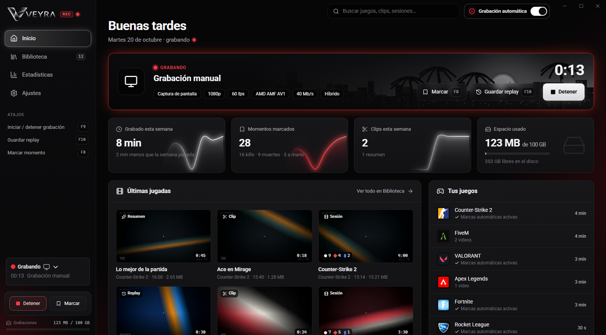
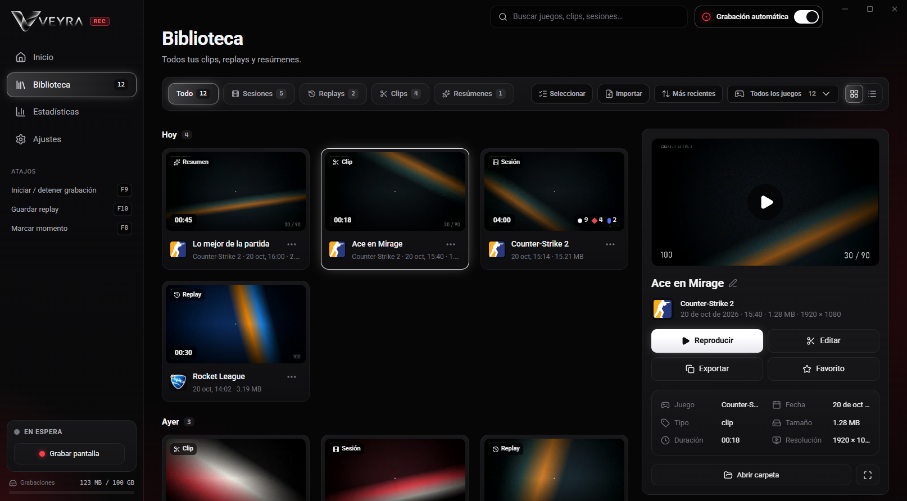
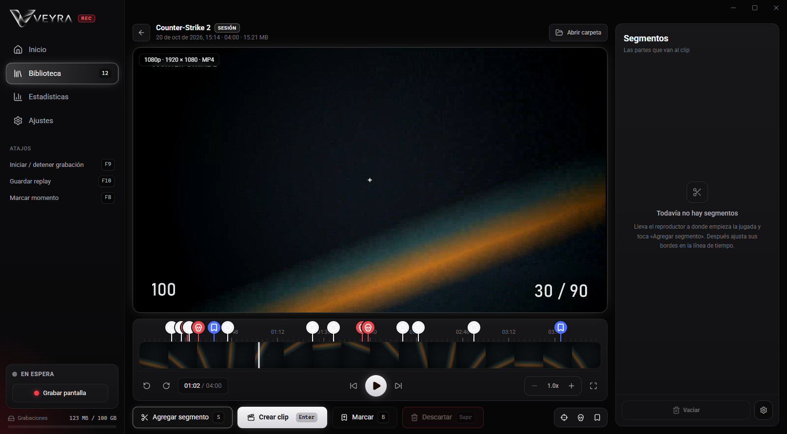
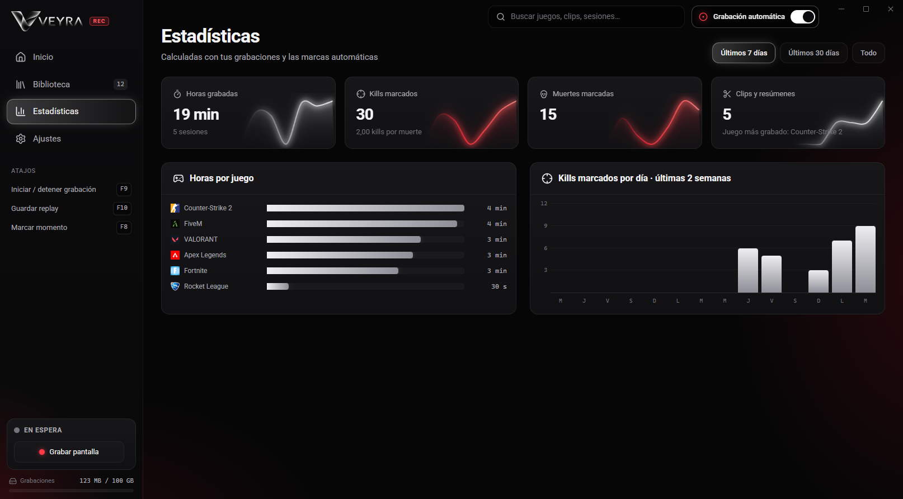
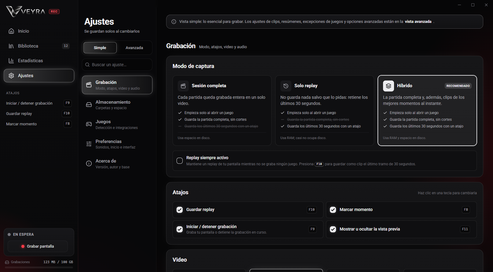

  

  <b>El grabador de partidas liviano para Windows.</b> 
  Graba solo cuando abres un juego, guarda tus mejores momentos con una tecla y hace clips al instante. 
  Sin cuenta, sin anuncios y con todo en tu PC.

  <a href="https://github.com/CodigoF-Dev/veyra-descargas/releases/latest/download/Veyra-Instalador.exe"><b>⬇ Descargar Veyra para Windows</b></a>
  &nbsp;·&nbsp;
  <a href="../../releases/latest">Novedades de la última versión</a>

  

## Qué hace

- **Graba sola.** Detecta el juego cuando lo abres y empieza a grabar, sin que toques nada. Si prefieres decidir tú, apaga la **grabación automática** con el interruptor de arriba y graba con un botón o con `F9`.
- **Nunca pierdes una jugada.** En modo **Híbrido** guarda la partida completa y además retiene los últimos 30 segundos: aprieta `F10` y esa jugada queda guardada como replay.
- **Marca los momentos por ti.** En Counter-Strike 2, VALORANT, Fortnite, League of Legends, Rocket League, Apex, Overwatch, FiveM y otros juegos anota sola tus kills, muertes y goles. Con `F8` marcas lo que quieras a mano.
- **Clips al instante.** El editor corta sin recodificar: un clip de cualquier largo sale en menos de un segundo y con la misma calidad que la grabación.
- **Resúmenes automáticos.** Junta tus mejores momentos de la partida en un solo video.
- **Listo para compartir.** Copia un clip y pégalo directo en Discord o WhatsApp, comprimido al tamaño que elijas.
- **Pulsar para hablar.** Tu micrófono entra en la grabación solo mientras sostienes la tecla.
- **Estadísticas reales.** Horas jugadas por juego, kills, muertes y clips, calculadas con tus propias grabaciones.

## Liviano de verdad

Veyra graba con el motor de OBS y usa el codificador de video de tu placa (NVIDIA, AMD o Intel), un chip aparte que el juego no usa. Por eso casi no le quita fps al juego.

Esto midió CodigoF en su PC, grabando a 1080p, 60 fps y 60 Mb/s con la ventana minimizada:

| | Veyra grabando |
|---|---|
| CPU | menos de 1 % |
| RAM | unos 350 MB, sin crecer con el tiempo |
| GPU del juego (3D) | 1,5 % |
| Cuadros perdidos | 0 en 6 minutos y medio |

En reposo, Veyra baja a 0,04 % de CPU.

## Así se ve

**Biblioteca:** todas tus sesiones, replays, clips y resúmenes en un solo lugar, con búsqueda, favoritos y filtro por juego.

**Editor:** las marcas de kills, muertes y momentos aparecen en la línea de tiempo. Agrega segmentos con `S` y crea el clip con `Enter`.

**Estadísticas:** lo que jugaste esta semana, este mes o desde siempre.

**Ajustes:** una vista simple con lo esencial y otra avanzada para quien quiere todo el control. Se guardan solos.

## Instalar

1. Descarga **[Veyra-Instalador.exe](https://github.com/CodigoF-Dev/veyra-descargas/releases/latest/download/Veyra-Instalador.exe)**.
2. Ábrelo y sigue el asistente: aceptas los términos de uso, eliges la carpeta (o dejas la de siempre) y decides si quieres un acceso en el escritorio. No pide permisos de administrador y trae todo lo necesario. Si a tu PC le faltan WebView2 o Visual C++, los instala también.
3. Windows puede mostrar «Windows protegió su PC», porque el instalador no tiene un certificado comercial. Toca **Más información → Ejecutar de todas formas**.

**Requisitos:** Windows 10 u 11 de 64 bits. Se recomienda una placa de video NVIDIA, AMD o Intel con codificador de video; sin ella, Veyra graba con el procesador.

## Atajos

| Tecla | Qué hace |
|---|---|
| `F9` | Empezar o detener una grabación |
| `F10` | Guardar los últimos 30 segundos como replay |
| `F8` | Marcar el momento |
| `F11` | Mostrar u ocultar la vista previa |

Puedes cambiarlos en **Ajustes → Grabación → Atajos**.

## Actualizaciones

Veyra se actualiza sola. Busca versiones nuevas cada vez que arranca, cada 4 horas y cuando abres la ventana. Las baja en segundo plano y las instala cuando no estás grabando, así que nunca corta una partida. Cada actualización se verifica con su huella SHA-256 antes de aplicarse.

**¿Tenías Interframe Rec?** No tienes que hacer nada: la app pasa sola a Veyra con tus grabaciones, clips y ajustes.

## Privacidad

Veyra no pide cuenta ni inicio de sesión. Tus grabaciones quedan en tu PC y no se suben a ningún lado.

La app usa internet solo para lo suyo: busca actualizaciones en este repositorio y baja de los servidores de Segra la lista de juegos que reconoce, sus íconos y el motor de grabación de OBS. Nunca envía tus videos.

## Créditos y código fuente

Veyra es la versión que hizo **CodigoF** de [Segra](https://github.com/Segergren/Segra), el grabador de código abierto de Segergren, y graba con [OBS](https://obsproject.com). Se distribuye bajo la licencia **GPL-2.0**. Si quieres el código fuente completo de cualquier versión, pídelo en una [consulta](../../issues).
